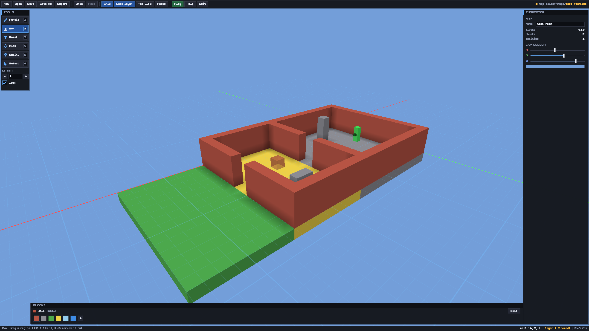
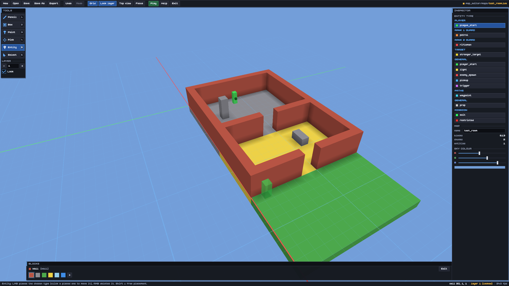
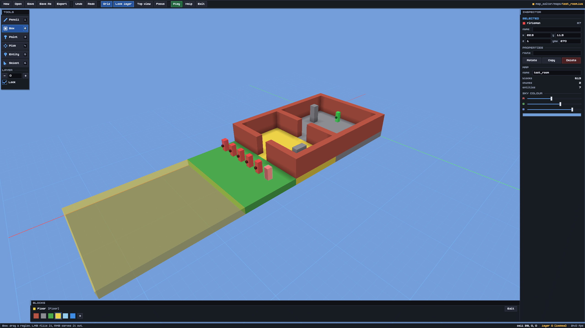
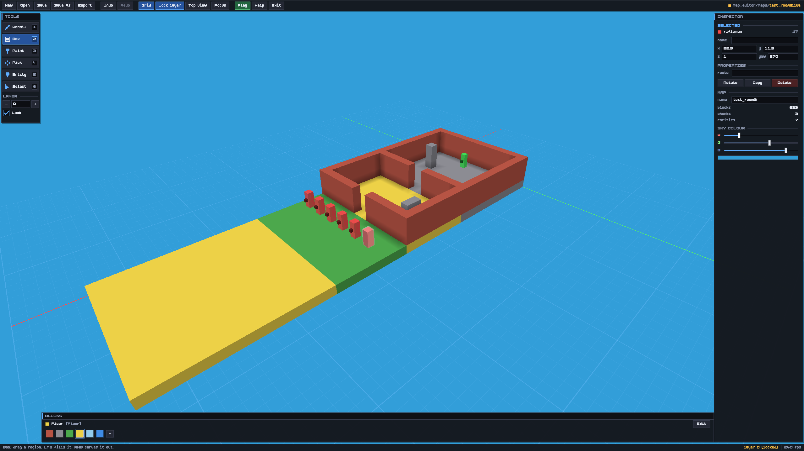

# map_editor

An in-engine **voxel level editor + runtime loader** for [LÖVE](https://love2d.org) and [g3d](https://github.com/groverburger/g3d) (Z-up). Build a level with the mouse, save it as a plain Lua file, then load and draw it in your game in two lines.

It is self-contained: the UI font ships inside the library folder and nothing depends on any particular game.

## Try the demo

1. Install [LÖVE](https://love2d.org) (11.x or 12).
2. Get [g3d](https://github.com/groverburger/g3d) and put its folder next to `main.lua`, so `g3d/init.lua` exists. Keep g3d's license file with it.
3. From this folder, run `love .`

You start in a free-fly view of `map_editor/maps/demo.lua`. Press **F8** to open the editor, **F1** for the shortcut list.

## Add it to your own game

Copy the **`map_editor/`** folder into your project (next to `main.lua`). Nothing else from this repo is needed. Your project also needs g3d, found automatically at `g3d`, `libs.g3d`, `lib.g3d`, `libraries.g3d`, `vendor.g3d` or `third_party.g3d`. If yours is elsewhere, pass it in with `Editor.g3d = require("my.path.g3d")` before opening the editor.

**Your `conf.lua` needs a depth buffer**, or the 3D view looks see-through (hidden faces draw over visible ones):

```lua
function love.conf(t)
  -- LÖVE 12 wants a boolean, LÖVE 11 wants a bit depth
  t.window.depth = ((love._version_major or 11) >= 12) and true or 16
end
```

The quickest wiring is to copy the pieces from [`main.lua`](main.lua). In outline:

```lua
local mapedit = require "map_editor"
local Editor  = require "map_editor.state"      -- the editor as a gamestate table
local g3d     = mapedit.findG3d()

Editor.onExit = function() Editor:leave(); --[[ back to your game ]] end
-- open it:   Editor:enter(nil, "map_editor/maps/demo.lua")
-- then forward love.update/draw/mousemoved/mousepressed/mousereleased/
-- wheelmoved/keypressed/keyreleased/textinput/resize to Editor while it is active.
```

It also works with `hump.gamestate`: `Gamestate.switch(Editor, "map_editor/maps/demo.lua")`.

### Loading a level in your game

```lua
level = mapedit.loadLevel("levels/mylevel.lua")   -- returns level, or nil + error
level:draw()                                      -- in love.draw, after g3d.camera is set up
level.map:isSolid(x, y, z)                        -- collision queries
level.map:firstEntity("player_start")             -- spawn points, triggers, ...
level:remesh()                                    -- after changing blocks at runtime with map:set(...)
```

The editor's **Export** button (Ctrl+G) writes the finished level into `Editor.gameDir` (default `levels/`).

### Editor settings

Set these on `Editor` before you switch to it. The full list with comments is at the top of [`map_editor/state.lua`](map_editor/state.lua).

| Setting | Purpose |
| --- | --- |
| `onExit()` | F10 / Exit button, after the unsaved-changes prompt |
| `onPlay(path)` | F6 plays the saved map in *your* game (nil disables F6) |
| `onExport(dest)` | called after Export wrote a level |
| `mapDir` / `gameDir` | where maps are saved and listed / where Export writes |
| `entityTypes` | extra entity types (chest, door, ...) |
| `palette` | function returning the block palette for new maps |

## Editor controls

Press **F1** in the editor for the same list.

| Keys | Action |
| --- | --- |
| **1-6** | Pencil, Box, Paint, Pick, Entity, Select tools |
| LMB / RMB | place / erase (Pencil, Box) |
| Q / E, `[` `]`, Shift+wheel | layer down / up |
| L / G | lock edits to the current layer / toggle grid |
| `,` `.` or Ctrl+wheel | previous / next block type |
| I | pick the block under the cursor |
| MMB drag or Alt+LMB | orbit |
| Shift+MMB or Alt+Shift+LMB | pan |
| Wheel | zoom |
| W A S D (Shift = faster) | move the camera |
| T / V | top view / side view |
| Z / C | swing the view 90° around the map |
| F / Home | focus selection or map / reset view |
| F9 | flip left-right if the cursor looks mirrored |
| R / Shift+R | rotate selected entity 90° |
| Del or X, Ctrl+D | delete / duplicate selected entity |
| Ctrl+Z, Ctrl+Y | undo / redo |
| Ctrl+S, Ctrl+Shift+S | save / save as |
| Ctrl+O, Ctrl+N | open / new |
| Ctrl+G | export to the game's level folder |
| F5 | play-test inside the editor |
| F6 | play the saved map in your game (`onPlay`) |
| F10 | leave the editor |
| F1 | help |

## Folder layout

```text
main.lua, conf.lua      demo runner (love .) and the example wiring to copy
map_editor/             the whole library: copy this folder, nothing else
  init.lua  state.lua  editor.lua  panels.lua  ui.lua  map.lua  mesher.lua ...
  fonts/  maps/         UI font and demo maps stay with the library
  LICENSE  CREDITS.md   travel with the library
tests/  tools/          run from the repo root, no LÖVE needed for tests
reference_screenshots/
```

### Tests and tools

From the repo root (plain `lua`, or `texlua` if that is what you have):

```text
lua tests/test_core.lua
lua tests/test_world.lua
lua tests/test_editor.lua
lua tools/make_demo.lua         # regenerates map_editor/maps/demo.lua
```

## Credits and license

Code is MIT, see [LICENSE](LICENSE). The UI font is BoldPixels by YukiPixels, see [map_editor/CREDITS.md](map_editor/CREDITS.md). **If you ship it, mention YukiPixels in your game's credits.**

## Screenshots

| Editor Overview | Box & Layer Locking |
| :---: | :---: |
|  |  |
|  |  |

| Box Tool & Sky Color | Sprite Placer & Play-Test |
| :---: | :---: |
|  |  |
|  |  |

| Exported Runtime Game (`loadLevel`) | Save As |
| :---: | :---: |
|  |  |
|  |  |