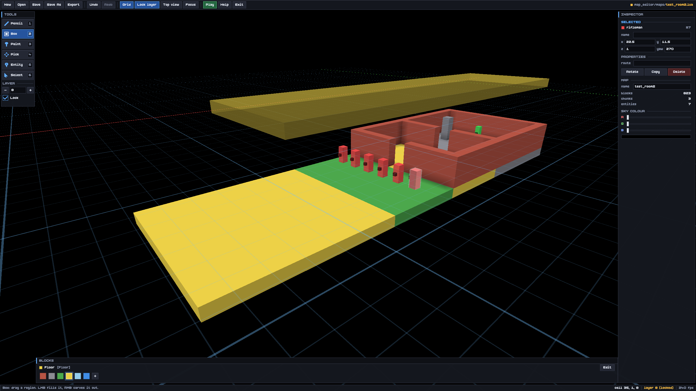
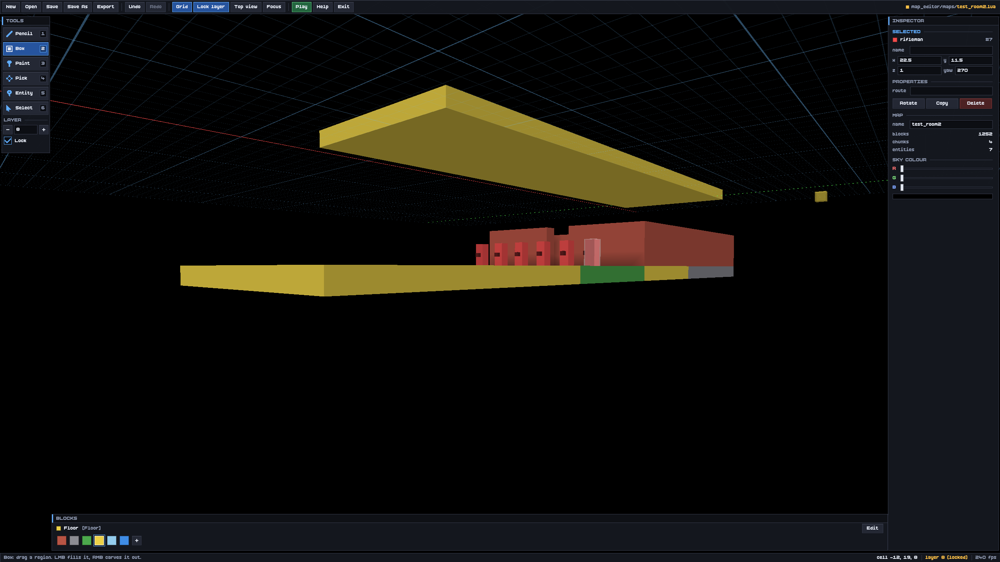
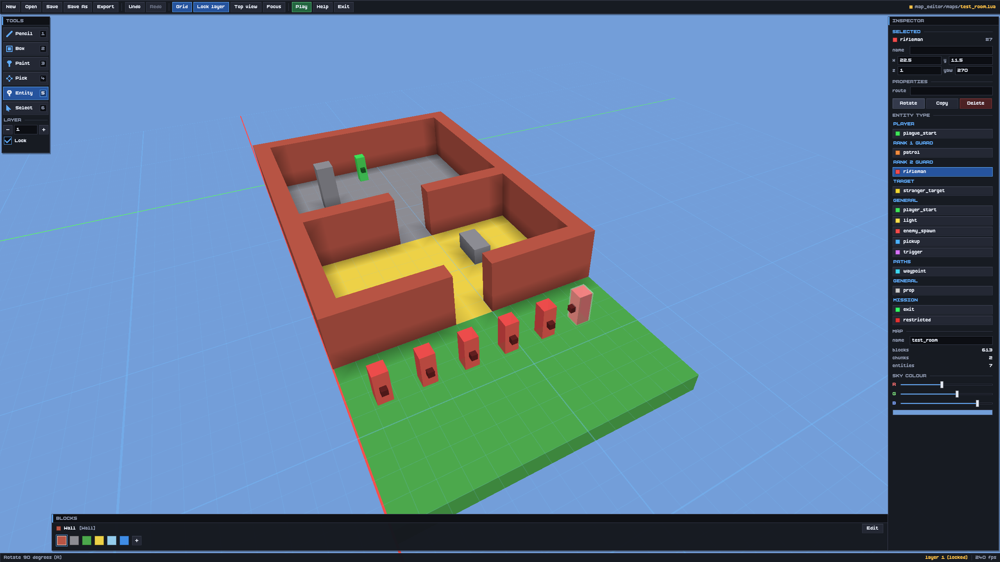
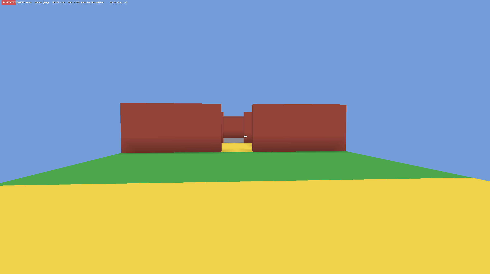
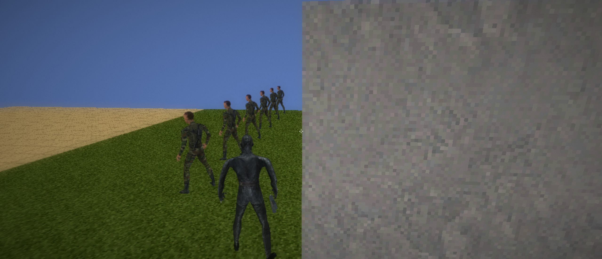
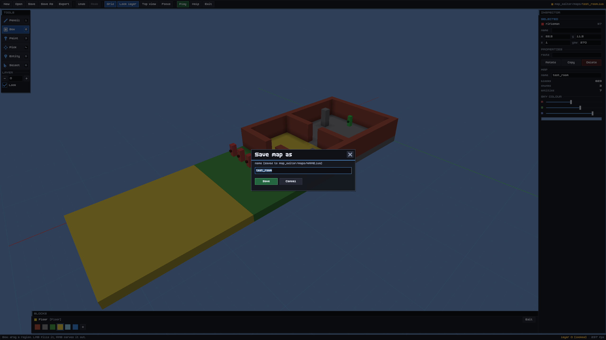
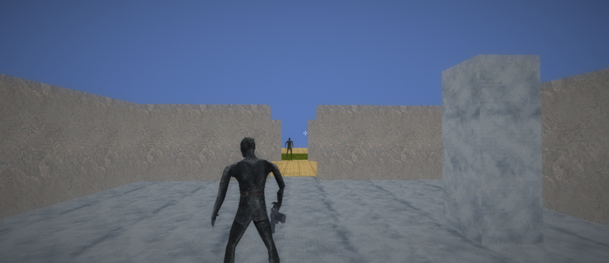
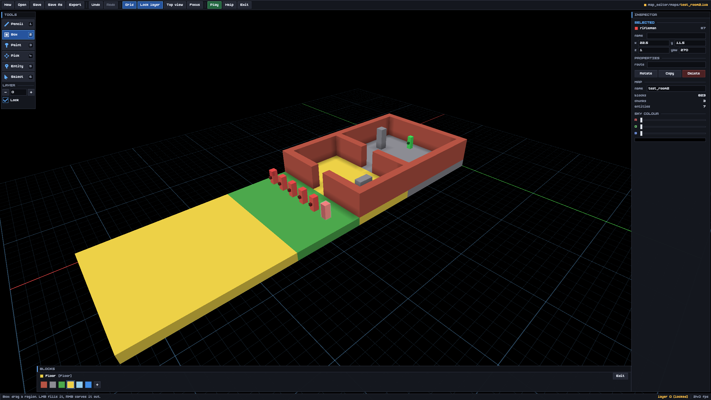

# map_editor

An in-engine **voxel level editor + runtime loader** for [LÖVE](https://love2d.org) and [g3d](https://github.com/groverburger/g3d) (Z-up). Build a level with the mouse, save it as a plain Lua file, load and draw it in your game with two lines.

It is self-contained: the UI font ships inside the folder and nothing here depends on any particular game.

## Screenshots

| Editor Overview | Box & Layer Locking |
| :---: | :---: |
|  |  |
|  |  |

| Box Tool & Sky Color | Sprite Placer & Play-Test |
| :---: | :---: |
|  |  |
|  |  |

| Exported Runtime Game (`loadLevel`) | Save As |
| :---: | :---: |
|  |  |
|  |  |